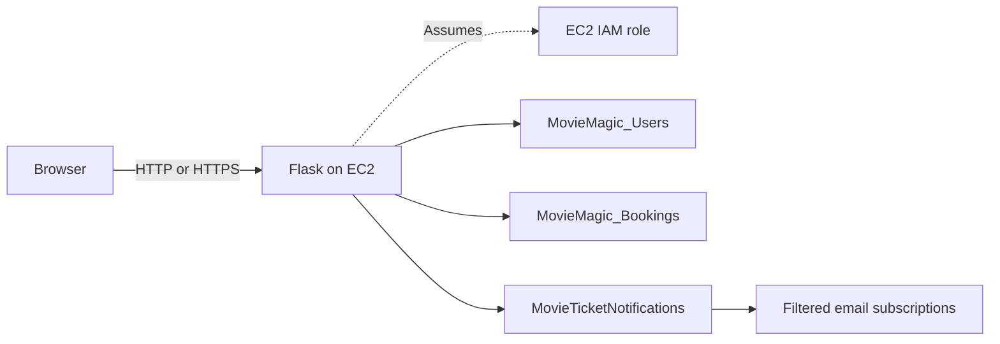
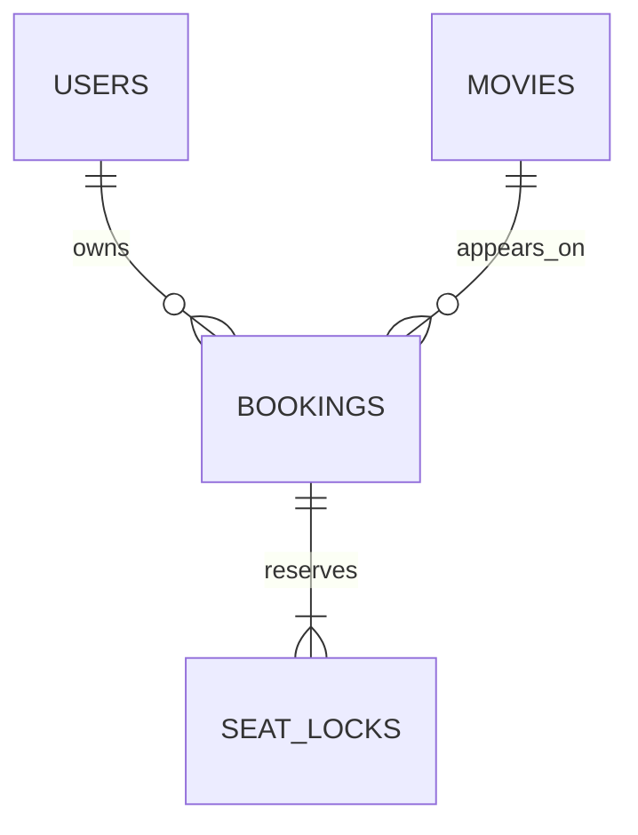
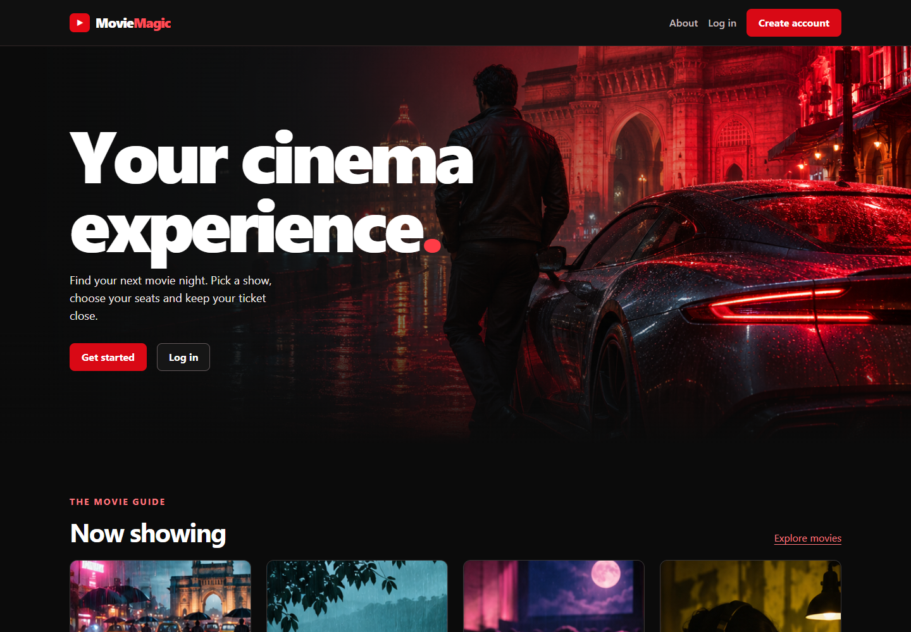

# MovieMagic

MovieMagic is a web app for browsing fictional movies and events, booking seats and receiving digital tickets. It runs locally with SQLite or on Amazon EC2 with DynamoDB and SNS.

- Twelve films and two events, with six Indian cities, local artwork, and theater-specific schedules and prices in rupees.
- Account registration and sign-in, location and genre filters, and an interactive 80-seat map.
- Atomic multi-seat reservations, simulated UPI and card payments, and pay-at-counter bookings.
- Printable tickets and private booking history, with local email simulation or filtered SNS notifications.

## Run locally on Windows

Use Python 3.12, the version used for local verification. From the project folder in PowerShell:

```powershell
powershell -ExecutionPolicy Bypass -File .\scripts\setup_local.ps1
.\.venv\Scripts\python.exe -m flask --app app run --host 127.0.0.1 --port 5000
```

Open `http://127.0.0.1:5000`. Register with demo details. The setup script creates a persistent development secret in the ignored `.env` file on first run. The app initializes its SQLite database in `instance/` and loads the catalog automatically.

On Linux, run `bash scripts/setup_local.sh`, then `.venv/bin/python -m flask --app app run`. Stop the server with Ctrl+C.

## Architecture and ER diagram





See [Architecture](docs/ARCHITECTURE.md) for both reference diagrams in Mermaid, the implemented data model, and the rationale for each difference, or open the [standalone ER diagram](docs/er-diagram.png).

## Project structure

```text
MovieMagic/
  app.py, config.py
  requirements.txt, requirements-dev.txt, .env.example
  data/          Fictional catalog, theaters and schedules
  services/      SQLite, DynamoDB, booking and SNS services
  templates/     Flask/Jinja pages
  static/        CSS, JavaScript and original image assets
  scripts/       Windows and Linux setup
  tests/         Flask and AWS adapter tests
  docs/          Architecture, deployment and submission materials
```

Flask, Jinja2, Werkzeug, Boto3, SQLite, and plain HTML/CSS/JavaScript form the application stack. EC2, DynamoDB, SNS and IAM provide the cloud runtime.

## Testing

```powershell
.\.venv\Scripts\python.exe -m pytest -q
```

See [Testing](docs/TESTING.md) for scope and browser and lab checks.

## GitHub and AWS

Create an empty repository in your own GitHub account. From the project folder, use:

```powershell
git init
git add .
git status --short
git commit -m "Build MovieMagic booking application"
git branch -M main
git remote add origin https://github.com/siddeshauti111/MovieMagic.git
git push -u origin main
```

Inspect the staged files before committing. `.gitignore` excludes `.env`, SQLite files, private keys and virtual environments.

Follow [AWS setup](docs/AWS_SETUP.md) and [EC2 deployment](docs/DEPLOYMENT.md). The official table partition keys are `email` and `booking_id`. The official lab URL format is `http://EC2_PUBLIC_IP:5000`.

## Security and limitations

Passwords use Werkzeug hashes. State-changing requests require CSRF tokens, authenticated routes verify ticket ownership, and checkout resolves prices from the catalog. Use secure cookies with HTTPS. AWS secrets belong in a protected environment file and AWS API permissions come from the instance profile.

The catalog uses fictional data and a rolling two-week schedule. Payments are simulated. Booking history uses a paginated DynamoDB scan for the lab. Production use would require a higher-capacity data model, login rate limiting, email verification during registration, and an operational process to maintain SNS subscription filters. Email acceptance and inbox delivery are distinct outcomes.

## Screenshots and submission



[Registration](docs/screenshots/register.png) · [Login](docs/screenshots/login.png) · [Dashboard](docs/screenshots/dashboard.png) · [Search](docs/screenshots/search.png) · [Seat selection](docs/screenshots/booking.png) · [Mobile booking](docs/screenshots/booking-mobile.png) · [Confirmed ticket](docs/screenshots/ticket.png)

Follow the [submission checklist](docs/SUBMISSION_CHECKLIST.md) for registration, login, dashboard, search, booking, ticket and AWS evidence. The [demo script](docs/DEMO_SCRIPT.md) walks through a live demonstration. See the [project report](docs/PROJECT_REPORT.md) and [viva questions](docs/VIVA_QUESTIONS.md) for supporting material.
