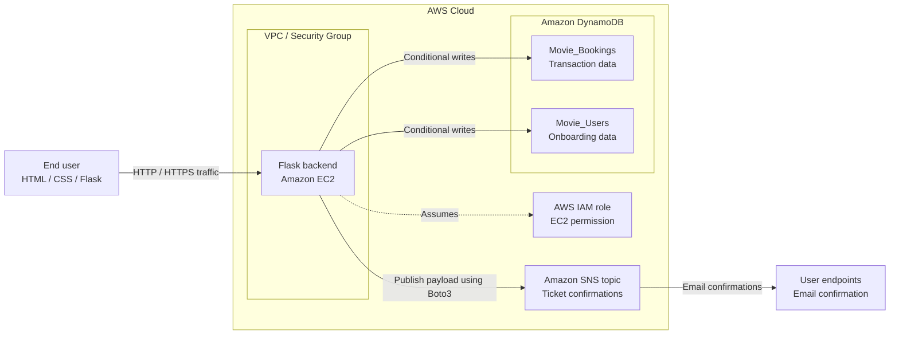
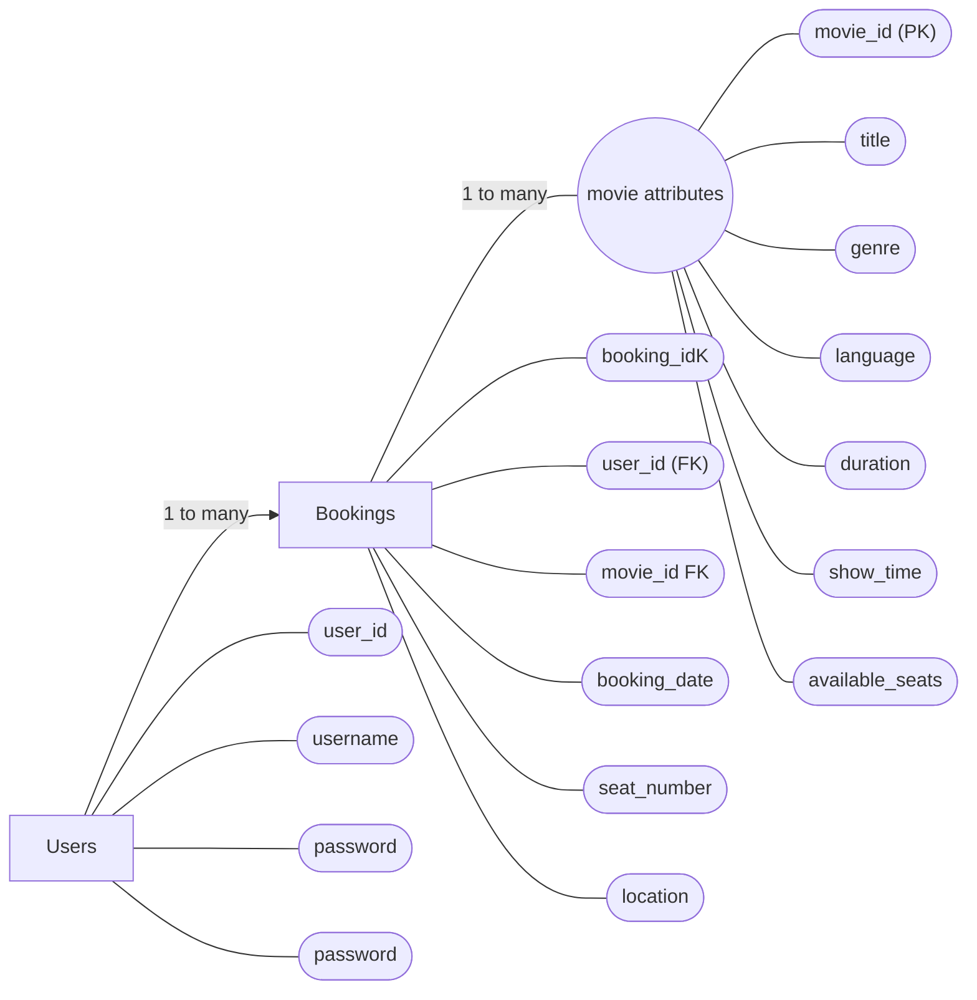
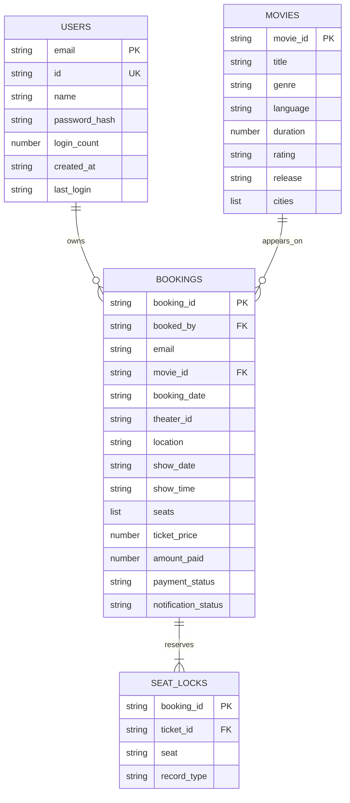

# Architecture and data model

## Technical architecture reference

## ER reference

The source is a Chen-style diagram. The Mermaid transcription retains the repeated password oval, the booking ID label as legible in the image, and the source's Bookings-to-movie link annotation.

The movie attribute grouping represents the right-hand cluster. The reference image does not show a separate Movies rectangle.

## Implemented logical ER diagram

## Reconciliation

| Reference detail | Implementation and rationale |
| --- | --- |
| Architecture labels `Movie_Users` and `Movie_Bookings` | The exact physical names from the detailed requirements take precedence. `MovieMagic_Users` has string PK `email`. `MovieMagic_Bookings` has string PK `booking_id`. Neither uses a sort key. |
| Movie relationship visually points from Bookings toward a cluster marked “1 to Many” | The master prompt defines one movie to many bookings. Each booking stores one `movie_id`. One user can own many bookings through the user's immutable ID in `booked_by`. |
| Username, duplicate password and user ID | Login uses normalized email. Display name maps to `name`. One Werkzeug hash replaces both password ovals. The generated user ID remains the logical booking reference. |
| Movie entity and two physical DynamoDB tables | `data/movies.json` supplies titles and the city-to-theater schedule and price mapping. The catalog loads at startup in both modes. |
| Movies showtime and available seats | Showtimes come from the theater schedule and are qualified by date. Availability is derived from committed locks for a movie, theater, date and time. A ticket stores an ordered list of seats and a snapshot of the customer, theater and price. |
| Single booking ID partition key | A `BOOKING` item uses `MVM-YYYYMMDD-XXXXXXXX`. A `SEAT_LOCK` item uses `LOCK#<show SHA-256>#<seat>`. One transaction conditionally inserts the ticket and all its locks. SQLite uses a transaction and unique keys with equivalent behavior. |
| SNS broadcasts to confirmed subscribers | AWS mode requires an SNS topic ARN. Detailed confirmations require explicit opt-in following verification of every subscriber filter. Local mode logs a simulated notification keyed by booking ID. |
| SES, S3, CloudWatch and library wording in reference materials | SNS is the email channel in the detailed architecture. S3 can later serve public artwork and CloudWatch can collect sanitized operational logs. The workflow here concerns cinema customers and bookings. Lab administrators configure resources via the console. |

## Request flow

1. Flask conditionally inserts the normalized account. Sign-in verifies the hash and atomically increments the login counter.
2. Flask filters the catalog and validates the theater and show. All dates and schedules use IST.
3. Seat availability uses deterministic lock lookups. The UI refreshes on date and time changes and offers manual refresh.
4. Checkout validates the account email, customer inputs, seats and payment option, then calculates price from the catalog. A conflicting seat rolls back the whole transaction.
5. Flask publishes to SNS after commit and saves the notification status. Signed-in ticket and history views enforce user ownership. AWS history uses a paginated filtered scan, suitable for the lab scale.

The 5 RCU / 5 WCU settings are the official lab defaults. Seat lookups and transactional writes consume capacity and can be throttled during bursts. A failed availability request disables seat selection until a successful refresh. The seat locks remain the final source of concurrency protection.
